# Network Security Monitoring with Suricata and Wazuh

A hands-on network security monitoring (NSM) project built on top of my Active Directory lab. I deploy **Suricata** as a network IDS on my pfSense firewall, launch a real reconnaissance scan from Kali, and catch that scan at two independent layers: the network sensor (Suricata signatures) and the SIEM (Wazuh log correlation). I then drop down to the packet level in Wireshark and dissect the scan byte by byte, tracing a SIEM alert all the way back to the raw packet that caused it.

**What this project demonstrates in one line:** I detected the same nmap scan two different ways, a signature match at the network layer and a behavioral correlation at the SIEM layer, then proved both by reading the raw packets that triggered them.

---

## Skills demonstrated

- **Network security monitoring:** Suricata IDS, rule categories, signature-based detection, sensor placement
- **Firewall and routing:** pfSense (packages, NAT, interface configuration, system logging)
- **Log pipeline engineering:** syslog forwarding (pfSense to Wazuh over UDP 514), remote syslog listener configuration
- **SIEM analysis:** Wazuh correlation rules, decoders, MITRE ATT&CK mapping, alert triage
- **Packet analysis:** Wireshark display filters, the TCP three-way handshake, reading a scan at the packet level, following TCP streams
- **Offensive security:** nmap service and OS detection, understanding scan behavior from the attacker side
- **SOC analysis thinking:** defense in depth, investigation procedure, what to do with a recon alert

---

## Architecture: where the sensor sits

Suricata runs on the **LAN interface of pfSense**, so it inspects traffic crossing the firewall between the lab segment and its gateway.

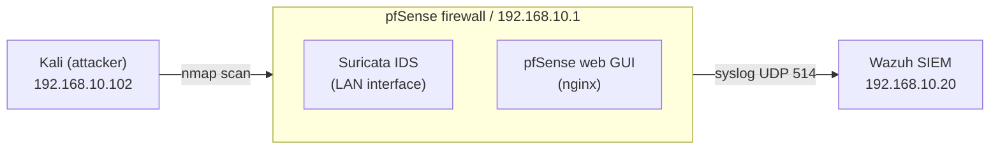

**A real lesson about sensor placement:** an IDS can only inspect traffic that physically reaches it. Two hosts on the same subnet (for example Kali scanning the Windows PC) talk through the switch directly, so that east-west traffic never crosses pfSense and Suricata is blind to it. I scanned the **gateway itself** (`192.168.10.1`) specifically because that traffic does reach the firewall, which is where the sensor lives. In a production network this is exactly why teams use a SPAN/mirror port, a network TAP, or host-based agents to cover traffic that does not naturally pass the firewall.

---

## The build

### 1. Suricata as an IDS on the LAN

I installed Suricata through the pfSense package manager and enabled it on the LAN interface in **IDS mode** (detect and alert, not block). Rulesets: **ET Open** and the **Snort GPLv2 Community** rules, which include the ET SCAN category that flags reconnaissance tooling.

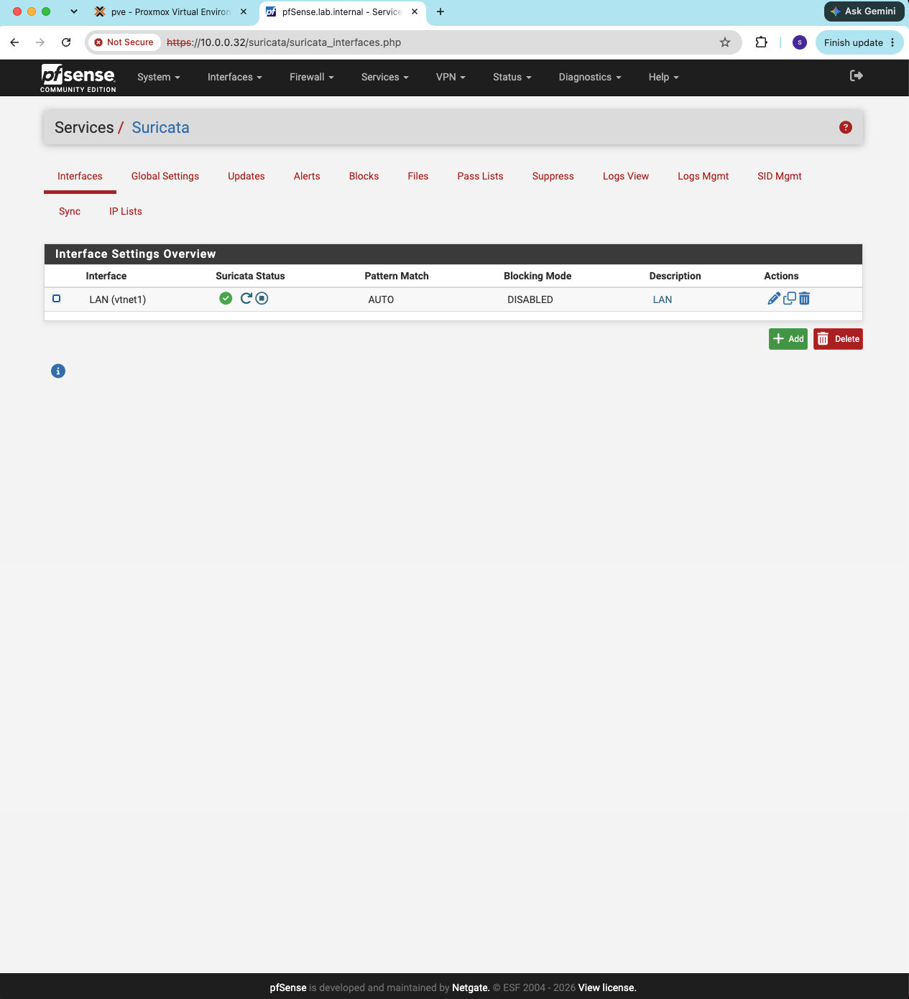

A note from the install: pfSense requires **hardware checksum offloading to be disabled** before Suricata will inspect packets correctly, because offloading hands checksum work to the NIC and the IDS then sees packets the host has not finished processing. That is a System, Advanced, Networking change plus a reboot.

### 2. Forwarding pfSense logs to Wazuh

pfSense ships its system log (including the Suricata and nginx entries) to the Wazuh manager over **syslog, UDP port 514**, using the LOCAL1 facility.

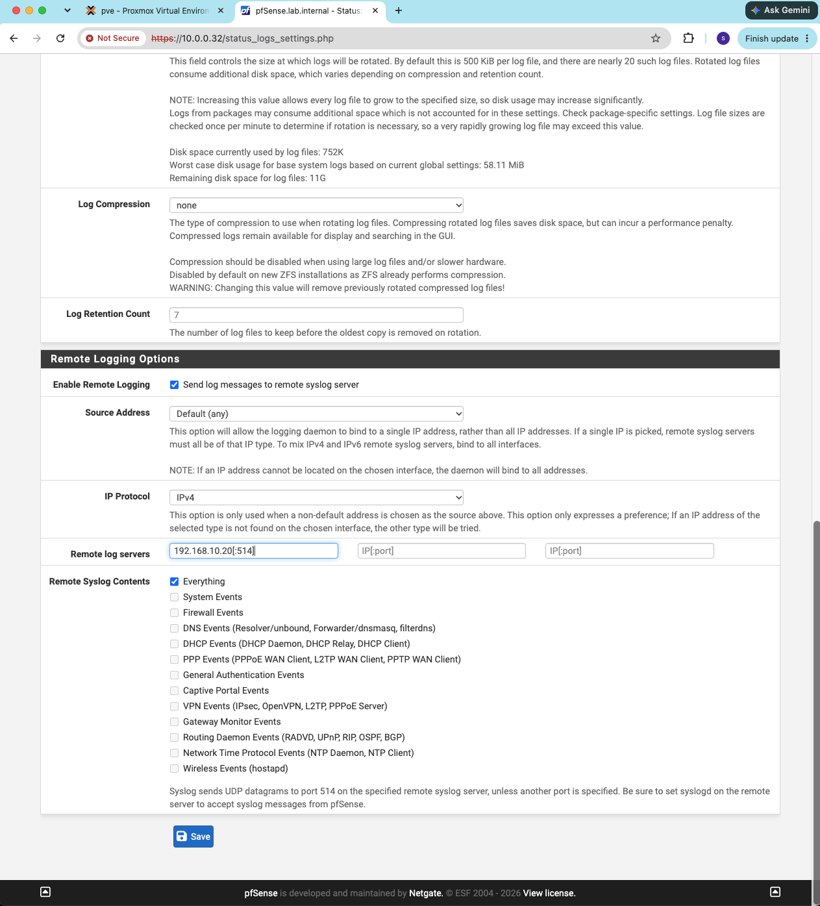

On the Wazuh side I added a remote syslog listener to `ossec.conf` so the manager accepts those messages from the lab subnet:

```xml
<remote>
  <connection>syslog</connection>
  <port>514</port>
  <protocol>udp</protocol>
  <allowed-ips>192.168.10.0/24</allowed-ips>
</remote>
```

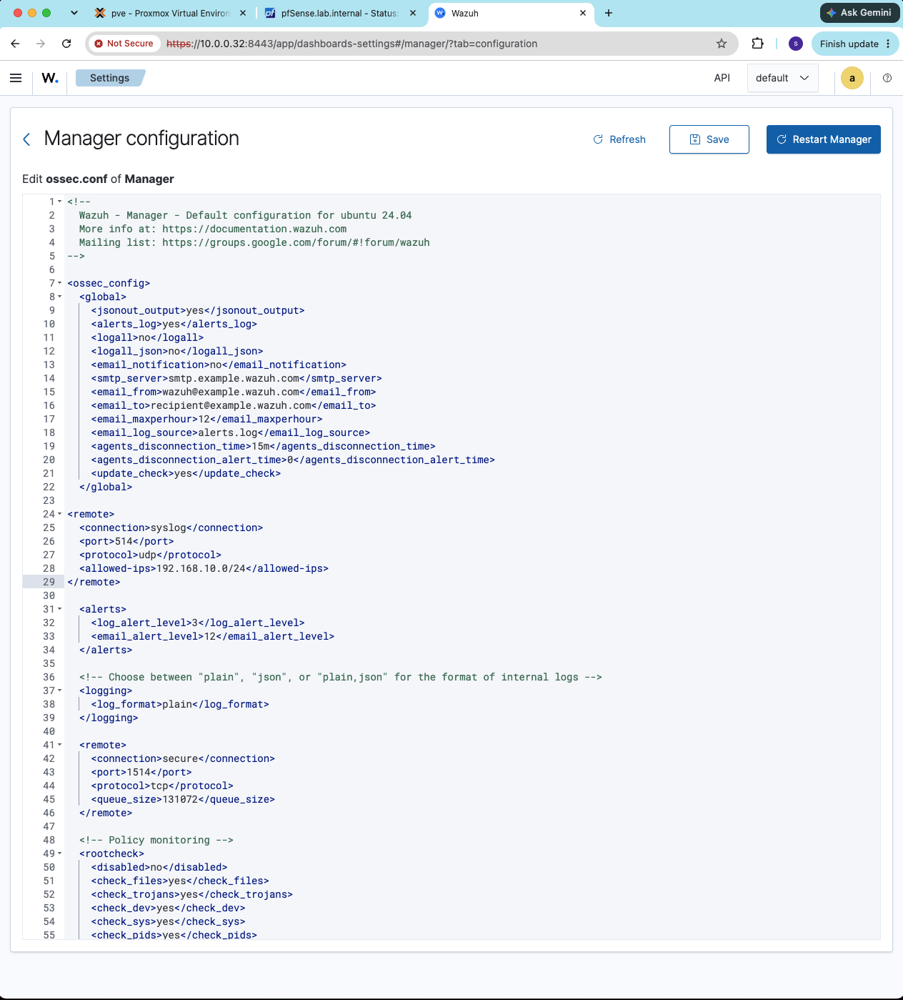

---

## The attack

From Kali I ran a full service and OS detection scan against the firewall:

```bash
sudo nmap -A 192.168.10.1
```

`-A` is aggressive: it does a port scan, service version detection, OS fingerprinting, and runs default NSE scripts. The scan found three open ports and even guessed the operating system (FreeBSD, which is correct, pfSense is built on FreeBSD).

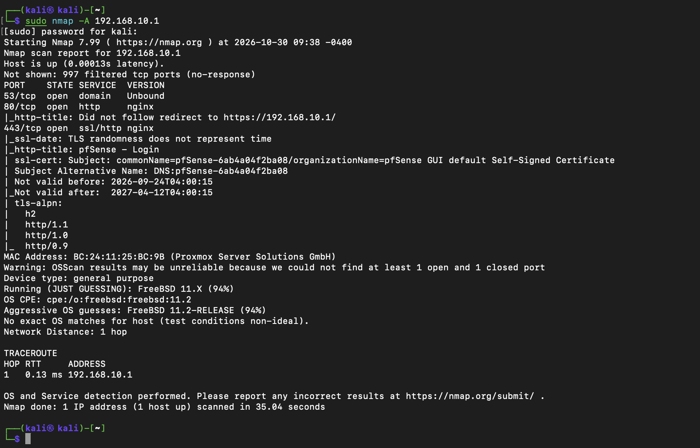

| Port | Service | Detail |
|------|---------|--------|
| 53/tcp | domain | Unbound (DNS resolver) |
| 80/tcp | http | nginx (redirects to HTTPS) |
| 443/tcp | ssl/http | nginx, pfSense login, self-signed cert |

---

## Detection layer 1: Suricata (network IDS)

Suricata matched the scan against its signatures and raised a burst of alerts. The key one is **`ET SCAN Possible Nmap User-Agent Observed`** (`GID:SID 1:2024364`): Suricata spotted the Nmap Scripting Engine's HTTP user-agent string in the traffic and flagged every request carrying it.

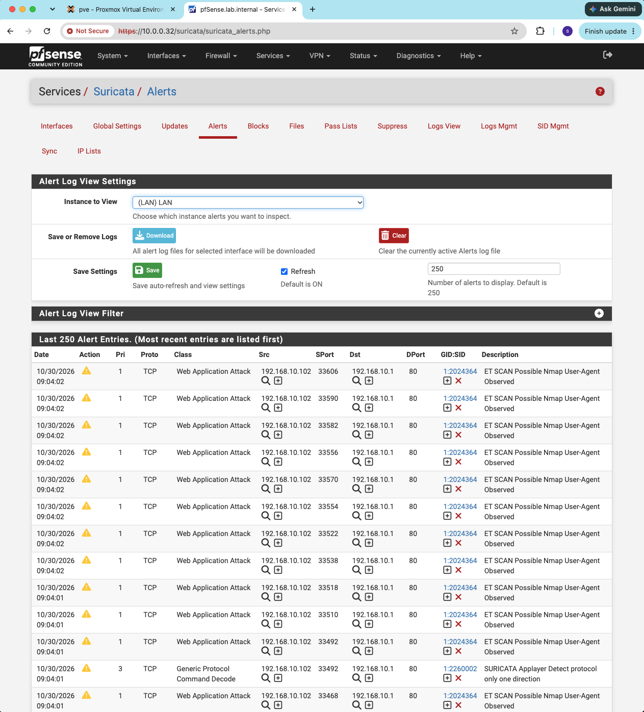

Every alert row names the attacker (`Src 192.168.10.102`), the target (`Dst 192.168.10.1`, port 80), and the signature. This is **signature-based detection**: a known-bad pattern matched a known rule. Fast and precise, but it only catches what it has a signature for.

---

## Detection layer 2: Wazuh (SIEM correlation)

The same scan was caught a second, independent way. pfSense's own nginx web server logged each NSE probe as it hit a nonexistent URL (`GET /HNAP1`, `GET /.git/HEAD`, and so on), returning a burst of **HTTP 404** responses. Those nginx logs flowed to Wazuh over syslog, where a built-in correlation rule noticed the pattern.

**Wazuh rule 31151, Level 10, "Multiple web server 400 error codes from same source ip."**

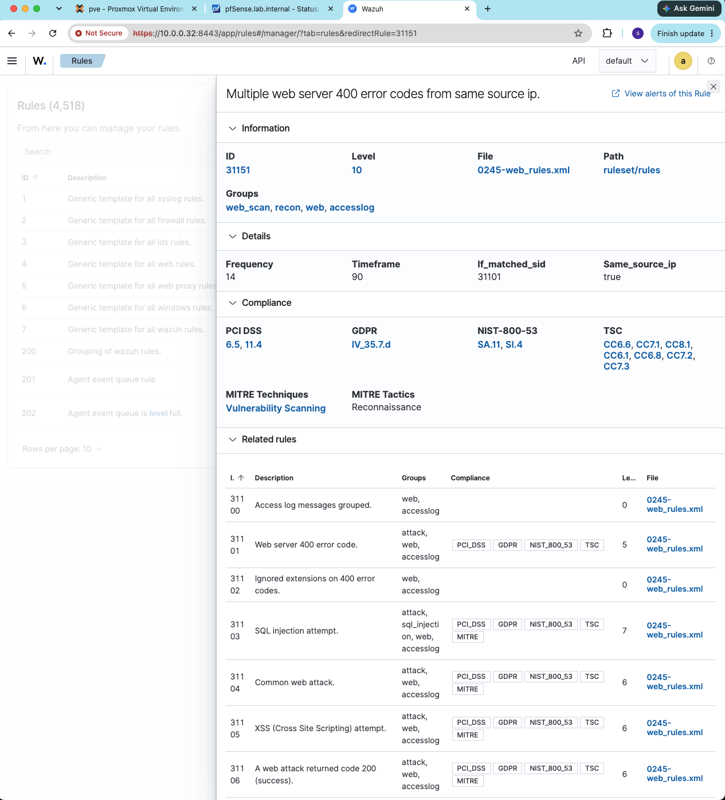

This is **behavioral / correlation detection**, a different philosophy from Suricata:

- `If_matched_sid 31101`: it builds on the base "web server 400 error" rule.
- `Frequency 14`, `Timeframe 90`: fire when 14 of those errors occur within 90 seconds.
- `Same_source_ip true`: all from one source.

One 404 is nothing. Fourteen 404s in 90 seconds from one host is a machine walking a list of URLs, which is scanning behavior. Wazuh maps it to **MITRE ATT&CK T1595.002 (Active Scanning: Vulnerability Scanning)** under the Reconnaissance tactic.

The expanded alert document shows the full evidence in one place: the raw nginx log line, the attacker's source IP, and the MITRE mapping.

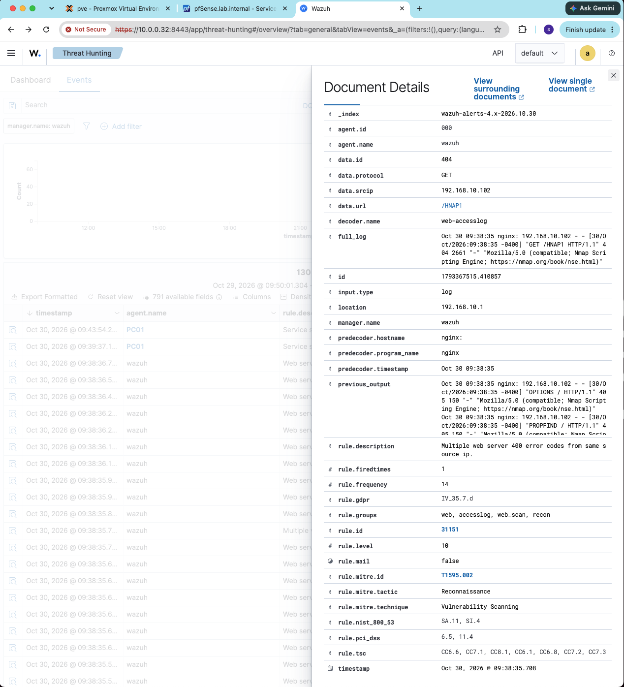

Note the `full_log` field: the actual access-log line, `"GET /HNAP1 HTTP/1.1" 404 ... "Mozilla/5.0 (compatible; Nmap Scripting Engine; https://nmap.org/book/nse.html)"`. The attacker's tool is named right there in the evidence.

**Why two layers matters:** Suricata caught the scan by its signature; Wazuh caught it by its behavior. If an attacker changed their user-agent to evade the Suricata signature, the behavioral 404-burst rule would still fire. That is defense in depth, and having both is what a real SOC relies on.

---

## Packet-level analysis in Wireshark

To truly understand what the sensors were reacting to, I captured the scan traffic on the pfSense LAN interface and opened it in Wireshark. Being able to trace an alert down to the exact packet that caused it is core SOC investigation work.

### The port scan

Filter: `tcp.flags.syn==1 && tcp.flags.ack==0`

Over 2,000 SYN packets from Kali, each probing a different port on the firewall. One host touching 1,000+ ports in seconds is the textbook signature of a port scan.

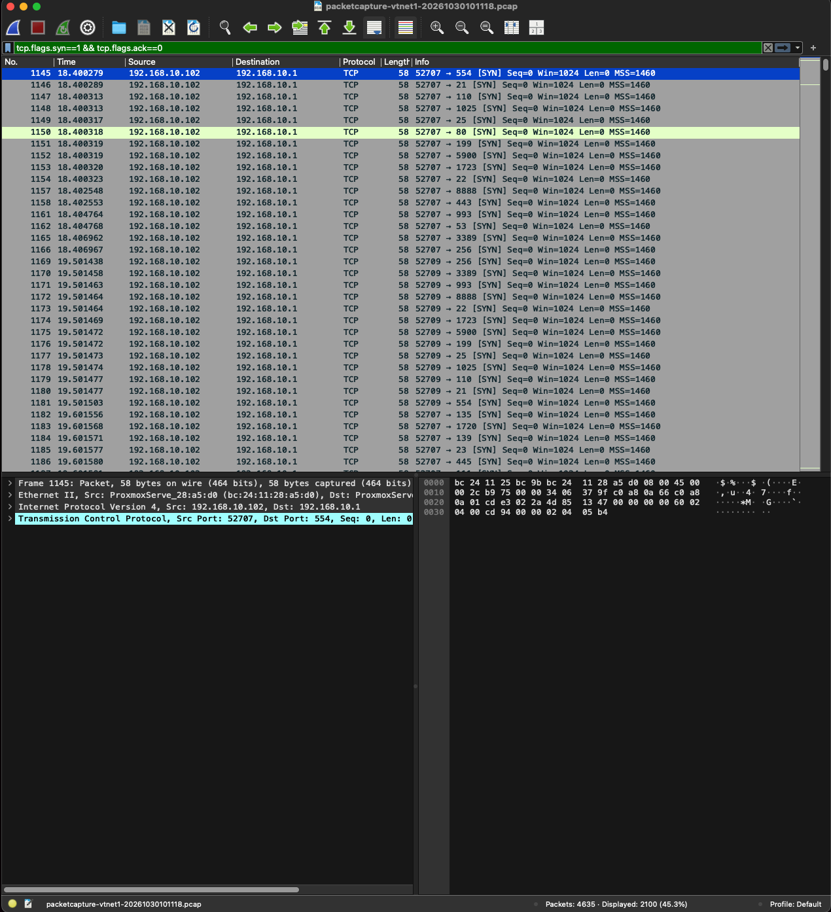

### The open ports

Filter: `tcp.flags.syn==1 && tcp.flags.ack==1`

Only open ports answer a SYN with a SYN-ACK. The replies come back on ports **53, 80, and 443**, confirming exactly what nmap reported.

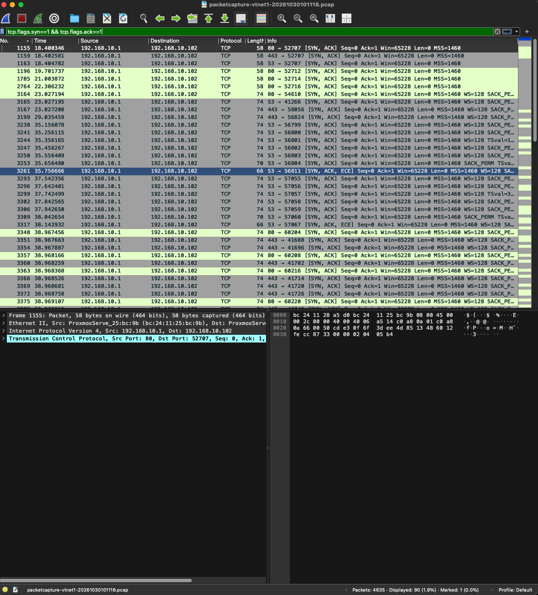

### The HTTP probes

Filter: `http.request`

Thirty requests from the NSE scripts, poking the web server for exposed paths and known applications: `/robots.txt`, `/.git/HEAD`, `/HNAP1`, and nmap's own `/nmaplowercheck` probe. No human browses like this.

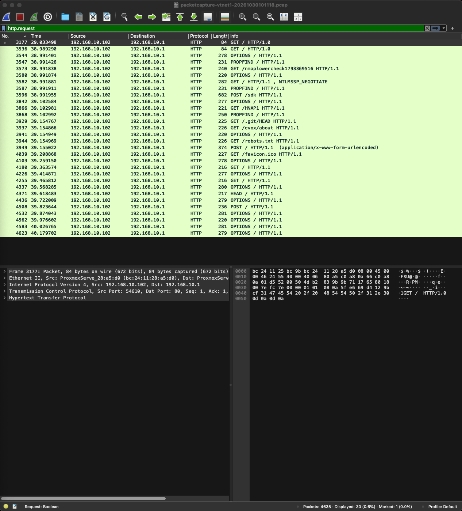

### The smoking gun (Follow HTTP Stream)

Following one of those HTTP streams shows the request and response in full. The **User-Agent** line is the exact string that tripped the Suricata signature and surfaced in the Wazuh alert.

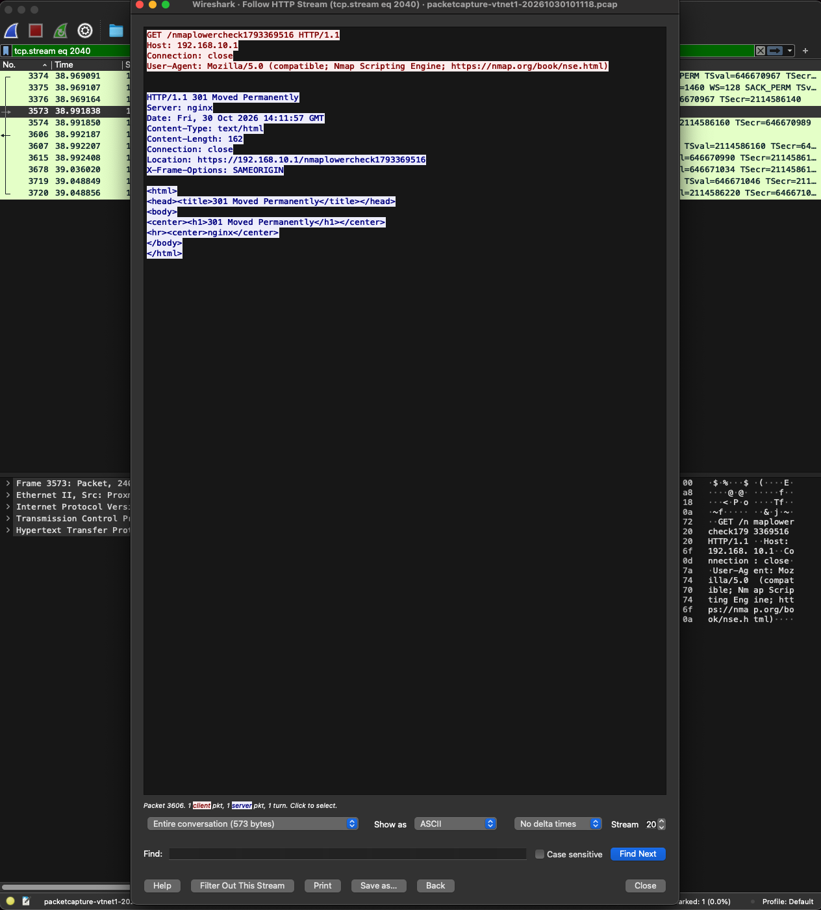

```
User-Agent: Mozilla/5.0 (compatible; Nmap Scripting Engine; https://nmap.org/book/nse.html)
```

This is the full chain, end to end: **raw packet on the wire, to IDS signature, to SIEM alert.**

### OS fingerprinting (ICMP)

Filter: `icmp`

Even the pings are crafted. nmap sends oversized ICMP echo requests with varying TTL values (50, 56, 57, 41) and varying payload sizes to study how the target's TCP/IP stack responds. That is how it guesses the operating system.

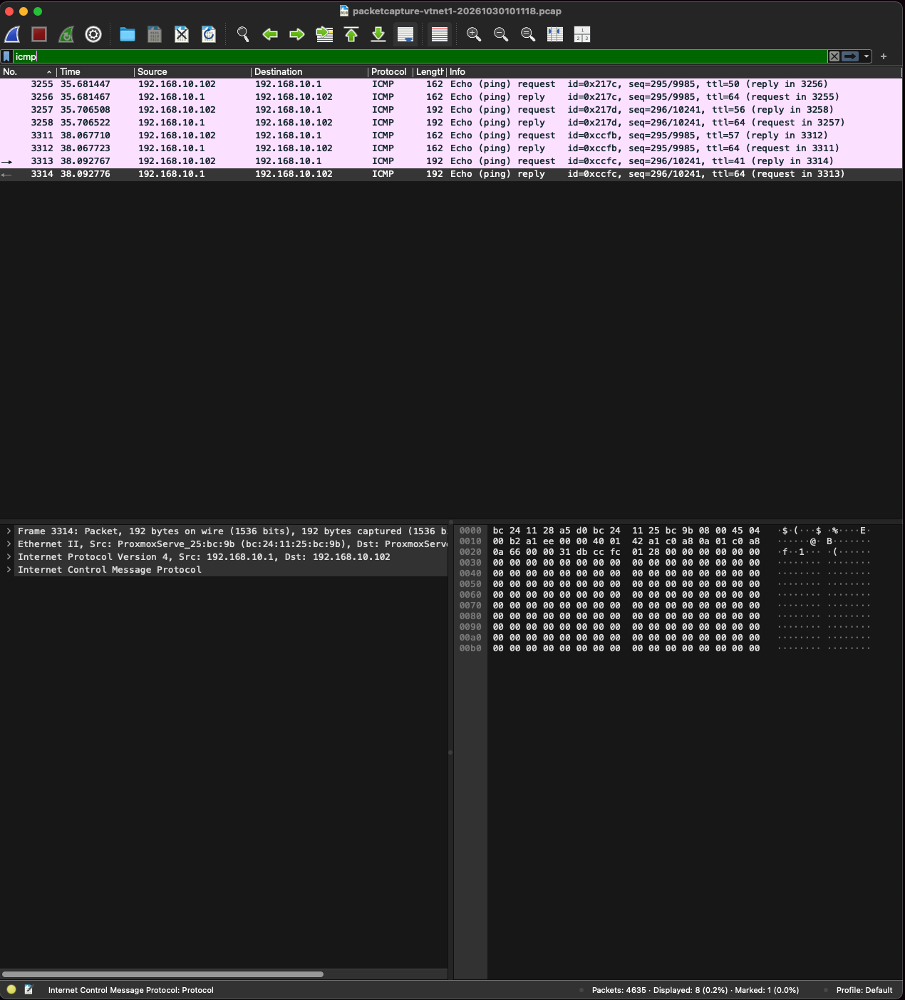

---

## SOC analyst perspective: responding to a recon alert

If I were the analyst who received this alert, blocking the source IP immediately is usually the wrong first move. The procedure I would follow:

1. **Scope it.** Is this one host or many? Internal or external source? A known admin or vulnerability scanner, or something unexpected?
2. **Investigate, do not tip off.** Recon is an early stage. Watching what the attacker does next (does it move from scanning to exploitation?) yields far more intelligence than an immediate block, which only tells them they were seen and pushes them to change tactics.
3. **Correlate.** Pull everything from that source IP across both the IDS and the SIEM. Build the timeline.
4. **Contain if it escalates.** If recon turns into exploitation attempts, then block or isolate, with evidence already in hand.

A scan is reconnaissance, not yet a breach. The value is in understanding intent and watching for the next move, not in reflexively swatting the first alert.

---

## Limitations and next steps

- **Suricata alerts are not yet enriched inside Wazuh.** pfSense forwards Suricata's `fast-log` syslog format, which does not match Wazuh's native Suricata (EVE/JSON) decoder. So Suricata's own alerts are visible in pfSense, and the SIEM correlation here comes from the nginx web logs rather than from Suricata's parsed output. Mapping Suricata's EVE JSON into Wazuh so its alerts are fully decoded and MITRE-tagged in the SIEM is the clear next step.
- **East-west coverage.** As noted above, same-subnet traffic does not cross the firewall, so this sensor cannot see host-to-host attacks inside the LAN. Adding a SPAN/mirror port or host-based agents would close that gap.
- **IDS, not IPS.** Suricata is in detect-only mode here. Switching to inline IPS mode (block, not just alert) is a natural extension, with the usual caution about false positives dropping legitimate traffic.

---

## A note on sanitization

This lab runs on an isolated private network. All addresses shown are internal RFC1918 addresses with no route to the internet. No real credentials appear in this writeup.
